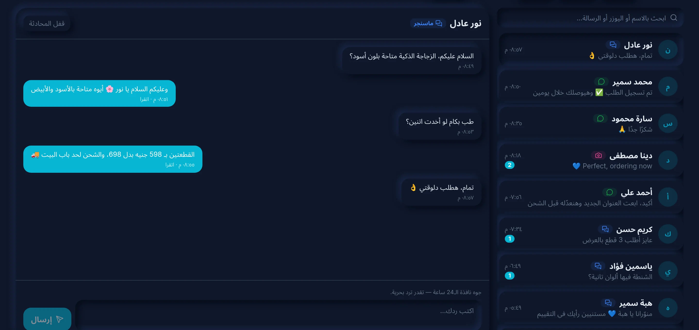

# 🏪 7alm — حلم

<div align="center">

**Arabic-first e-commerce with one inbox for Facebook, Instagram and WhatsApp.**
Storefront and RTL landing pages, a full order lifecycle with shipping, and replies to customer messages and post comments — in one app.

[](https://nextjs.org/)
[](https://nestjs.com/)
[](https://www.postgresql.org/)
[](https://kafka.apache.org/)
[](https://redis.io/)
[](https://docs.docker.com/compose/)

[Product site](https://mohamedjs.github.io/7alm/) · [Architecture](docs/ARCHITECTURE.md) · [Deploy](docs/INFRASTRUCTURE.md) · [Meta setup](docs/META_INTEGRATION.md)

</div>



## What's inside

| | |
| --- | --- |
| **Store & landing pages** | One ad-ready page per product (`/{slug}`), quantity offers, storefront with categories and cart. AR/EN, RTL/LTR, dark/light. |
| **Orders** | State machine `pending → approved → confirmed → shipped → delivered` (+ cancelled/returned), race-free stock reservation, Bosta booking, courier webhooks, coupons, admin e-mail, customer WhatsApp via n8n. |
| **Meta inbox** | Messenger, Instagram Direct and WhatsApp Cloud API conversations; public and private replies to Facebook/Instagram comments; hide spam. Follows Meta's 24 h / 7-day rules. |
| **CRM** | Customers by phone with order stats, WhatsApp history, verified-buyer reviews. |
| **AI Studio** | Campaigns, ad images and videos through OpenRouter, driven from Telegram (n8n). |

## Stack

- **backend/** — NestJS 11 **modular monolith** (domain / application / infrastructure / presentation per module), PostgreSQL 17 via **Prisma 7**, **Kafka** with a transactional outbox, **Redis** (cache, idempotency, rate limits, socket.io adapter). Two processes: `api` and `worker`.
- **src/** — Next.js 16 App Router, RTK Query, Tailwind 4. Presentation only.
- **Ops** — Docker Compose, Caddy (automatic HTTPS), daily `pg_dump`, GitHub Actions (CI, Pages, GHCR release).

## Run it

```bash
# development
docker compose up -d                                  # postgres, redis, kafka
cd backend && cp .env.example .env && npm ci && npx prisma migrate deploy && npm run seed:dev
npm run start:dev & npm run start:worker:dev &
cd .. && npm ci && BACKEND_URL=http://localhost:4000 NEXT_PUBLIC_API_WS_URL=http://localhost:4000 npx next dev -p 3001

# production (one VPS)
cp .env.production.example .env.production            # domain, secrets, Meta app
docker compose -f docker-compose.prod.yml --env-file .env.production up -d --build
```

Admin: `/admin` (first admin from `ADMIN_SEED_EMAIL` / `ADMIN_SEED_PASSWORD`). Meta webhook URL: `https://<domain>/api/webhooks/meta`.

## Quality gates

```bash
npx tsc --noEmit                               # web
cd backend && npm run typecheck && npm test    # domain, Meta parser, signature + architecture tests
node --env-file=.env test/smoke.mjs            # e2e checkout → delivered
node --env-file=.env test/meta-smoke.mjs       # e2e Meta webhooks → inbox → replies
```

For contributors and AI agents: [`AGENTS.md`](AGENTS.md).
